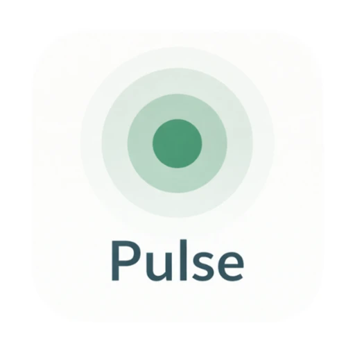
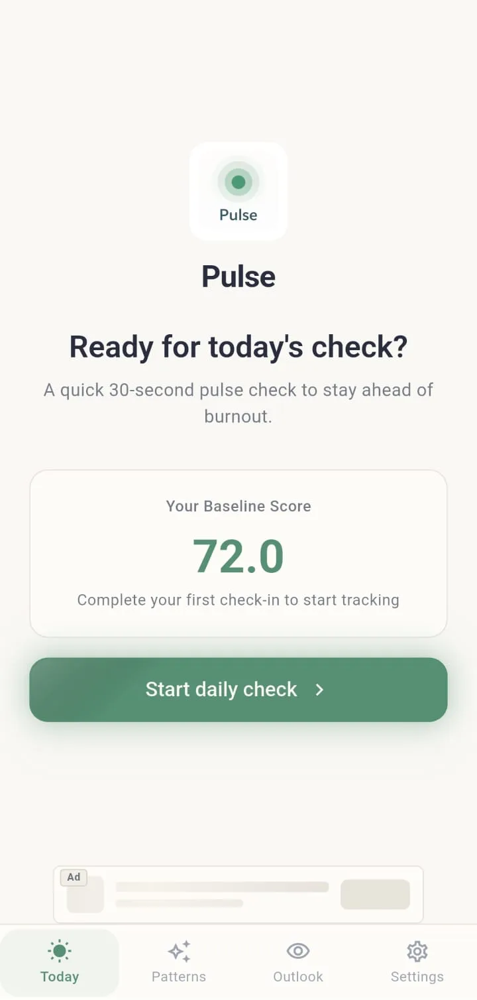
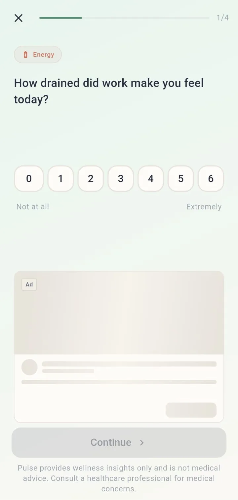
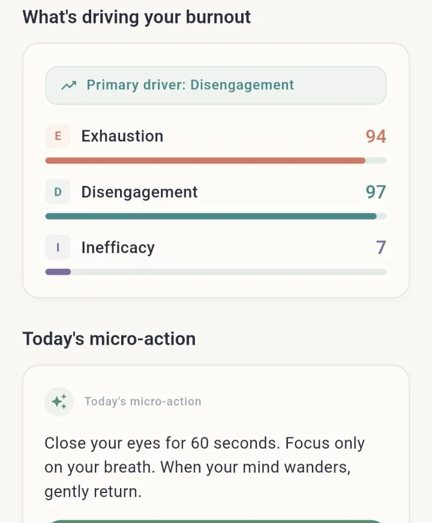
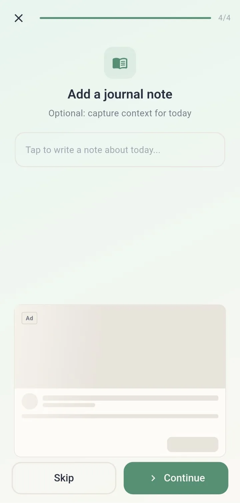
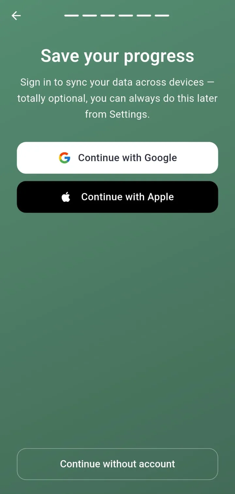
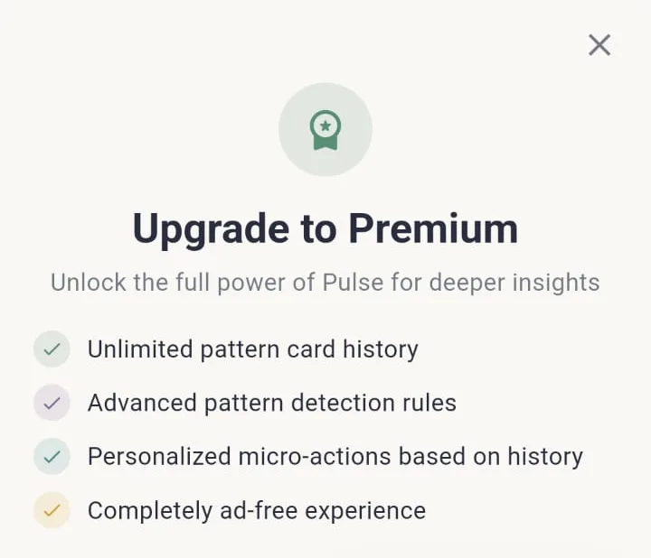
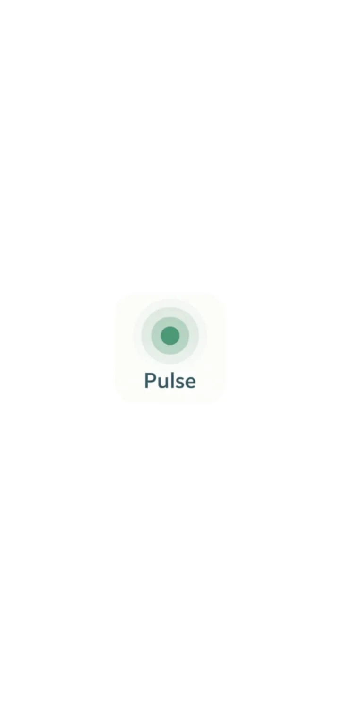
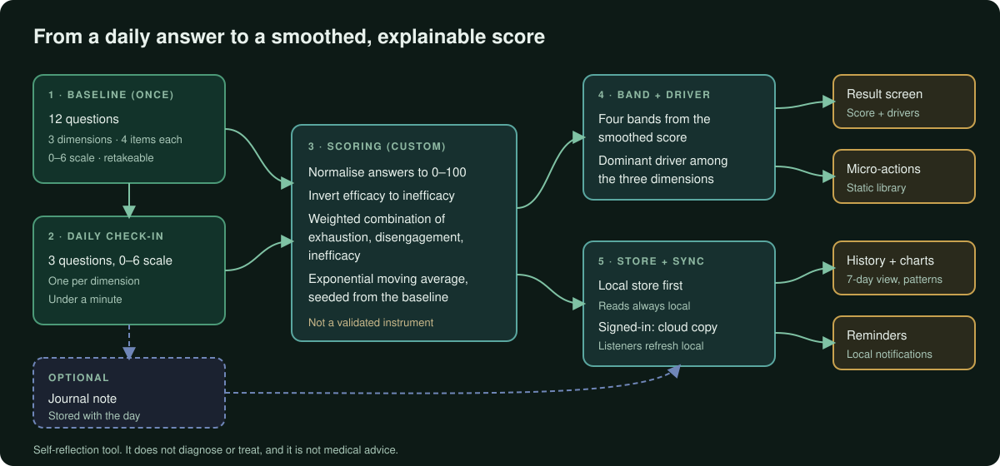
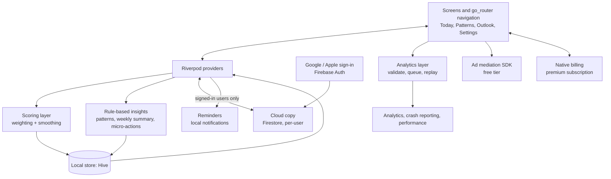

# Pulse: Burnout & Stress Check

**A local-first Flutter app for daily work-stress self-reflection: a 12-question baseline, a three-question daily check-in, and a smoothed score with per-dimension drivers.**

**Android · iOS** 
Flutter · Dart · Riverpod · Hive · Firebase

<table>
  <tr>
    <td valign="middle"></td>
    <td valign="middle"></td>
    <td valign="middle"></td>
  </tr>
</table>
Left to right: Today home, daily check-in question, and a per-dimension view of a sample check-in (cropped to the drivers and micro-action cards). Real screenshots from the Android build, cropped to the app content, captured with sample/placeholder data, metadata removed.

---

## Get the App

  
  

> **What this is, and is not.** Pulse is a self-reflection and tracking tool for work-related stress. It does not diagnose or treat anything, it is not a substitute for professional advice, and the app itself states that it provides wellness insights only and is not medical advice. This repository describes the software engineering, not health outcomes.

## Product at a Glance

| | |
|---|---|
| **What it is** | A daily self-check for work-related burnout and stress: answer a short questionnaire, see a smoothed 0-100 score, a band and the dimension driving it |
| **Check-in shape** | A one-time 12-question baseline, then three quick daily questions on a 0-6 scale, one for each of exhaustion, disengagement and inefficacy |
| **Scoring** | The app's own custom method: weighted combination of three dimensions, smoothed over time with an exponential moving average, mapped to four bands. Not a validated instrument, not a named standard implementation |
| **Around the score** | Optional journal note, per-driver identification, a static library of short micro-actions, 7-day chart and pattern cards, daily reminders, a simple day-count streak |
| **Data** | Local-first on the device (Hive); optional Google or Apple sign-in adds a cloud copy and restore on a new device; in-app account deletion. Push registration, remote ad configuration, analytics and crash reporting use cloud services for every install |
| **Business model** | Ads for free users through a mediation SDK; premium subscription through the native stores |
| **Platforms** | Android and iOS, one Flutter codebase (screenshots here are from the Android build) |
| **Localization** | 20 locale resource files, including right-to-left layout handling |
| **Code size** | About 35.5k lines across 148 hand-written Dart files in `lib/` (generated and localization code excluded) |
| **Tests** | 14 test files: scoring calculator, analytics layer, ad configuration and loading, paywall widget, screen tracking, motion and start-up |

## Live Product Showcase

<table>
  <tr>
    <td align="center"> <b>Optional journal note</b> Final step of the check-in; can be skipped</td>
    <td align="center"> <b>Save progress sign-in</b> Optional account with Google or Apple, or continue without one</td>
  </tr>
  <tr>
    <td align="center"> <b>Premium paywall: benefits list</b> Cropped to the heading and benefits; prices are not reproduced in this repository</td>
    <td align="center"> <b>Splash</b> Lightweight first screen while services start</td>
  </tr>
</table>

Placeholder ad slots visible in some screens belong to the free tier. All screenshots are from the Android build.

## How a Check-in Becomes a Score

  

The scoring is deliberately small and explainable: normalise each answer, combine three dimensions with fixed weights, smooth each over time so one hard day does not whipsaw the number, and map the result to one of four bands. The structure of three dimensions echoes what is often discussed in burnout literature. The weights, the short daily form, the smoothing and the bands are the app's own design, and the score is a self-reflection aid rather than a clinical measure. Weights and thresholds are intentionally not published here. Details: [docs/TECHNICAL_CASE_STUDY.md](docs/TECHNICAL_CASE_STUDY.md).

## Engineering Highlights

### A noisy daily self-report becomes a steadier number
- **Problem:** three taps a day swing with the day; a raw score would jump around and feel arbitrary.
- **Approach:** normalise, invert efficacy so all three dimensions point the same way, combine with weights, then smooth each dimension with an exponential moving average seeded from the baseline. Band and dominant driver come from the smoothed values.
- **Outcome:** one deterministic, dependency-free scoring pipeline with unit tests for normalisation, weighting, bands, tie-breaks and smoothing.

### Local-first, with the cloud as an optional copy
- **Problem:** people without an account must get the full experience, while signed-in people expect multi-device restore, and both must share one UI.
- **Approach:** the UI reads only from local storage. For signed-in users, writes go to a per-user cloud store, snapshot listeners refresh local data, a first-sync merge rule decides which side wins, and a stale-sync guard plus a safety upload protect sign-out and reset.
- **Outcome:** one read path for every user, with sync layered on top.

### Analytics and ads that wait for the iOS tracking prompt
- **Problem:** analytics collection and ad initialisation must not start before the user answers the iOS tracking-transparency prompt, and the prompt itself must be requested exactly once.
- **Approach:** a native bridge de-duplicates the request, analytics events are queued while it is pending and replayed in order afterwards, and a timeout prevents the queue from hanging.
- **Outcome:** deterministic start-up ordering across Firebase, the tracking prompt and the ad SDK.

### More
| Area | What was built |
|---|---|
| **Account deletion** | Provider-specific re-authentication, deletion of the user's cloud documents, removal of the auth user and push token, then a full local reset |
| **Ads** | Mediation SDK through a locally maintained plugin fork with a native preload cache; remote per-placement and global switches that fail closed when a value is missing |
| **Subscriptions** | Native billing through the stores with a launch-time silent restore; premium state kept on the device and refreshed from the store |
| **Rule-based insights** | Weekly summaries and pattern cards are templated, rule-driven text rebuilt in the current language at render time |
| **Localization** | 20 locale resource files; layout direction flips for right-to-left languages; reminder text follows the saved language |
| **Observability** | Event analytics with a validating, queuing layer, crash reporting and performance traces around start-up, sync and ad loading |

Problem, approach, outcome and trade-offs in full: [docs/ENGINEERING_CHALLENGES.md](docs/ENGINEERING_CHALLENGES.md).

## Architecture

More diagrams and component responsibilities: [docs/ARCHITECTURE.md](docs/ARCHITECTURE.md).

## Technology Stack

| Layer | Technology |
|---|---|
| App framework | Flutter / Dart |
| State management | Riverpod |
| Navigation | go_router with a tabbed shell and an onboarding redirect |
| Local persistence | Hive, plus shared preferences for lightweight settings |
| Models | Immutable models with generated serialization |
| Cloud | Firebase Auth, Cloud Firestore, Cloud Messaging, Analytics, Crashlytics, Performance Monitoring |
| Sign-in | Google; Sign in with Apple; or no account |
| Charts | Custom-painted charts, no charting library |
| Notifications | Local notifications; scheduled background work on Android; native repeating trigger on iOS |
| Ads | Mediation SDK via a locally maintained plugin fork |
| Billing | Store billing through the Flutter in-app purchase plugin |
| Localization | Flutter generated localizations, 20 locale files |
| Tooling | Code generation, lints, mocking for tests |

## Project Scope

Pulse is a production application on Android and iOS. This portfolio focuses on the engineering: the scoring pipeline, the local-first data model and sync, platform integration details and the monetisation and observability layers. It makes no claims about health outcomes, user numbers or ratings.

## Documentation

| Read | For |
|---|---|
| [Product overview](docs/PRODUCT_OVERVIEW.md) | What the app does, screens and the daily loop |
| [Technical case study](docs/TECHNICAL_CASE_STUDY.md) | End-to-end technical write-up |
| [Architecture](docs/ARCHITECTURE.md) | Diagrams and component responsibilities |
| [Engineering challenges](docs/ENGINEERING_CHALLENGES.md) | Problem, approach, outcome and trade-offs |
| [Privacy and source](docs/PRIVACY_AND_SOURCE.md) | What is and is not published |

## Source Code

This repository is a portfolio showcase for a production application. Production source code is maintained privately. See [RIGHTS.md](RIGHTS.md) for usage terms.
