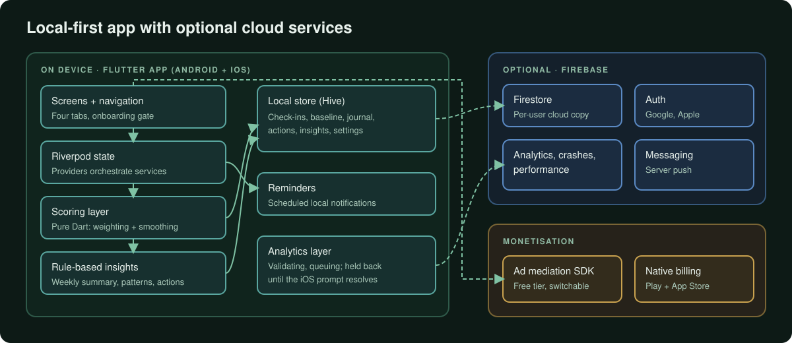
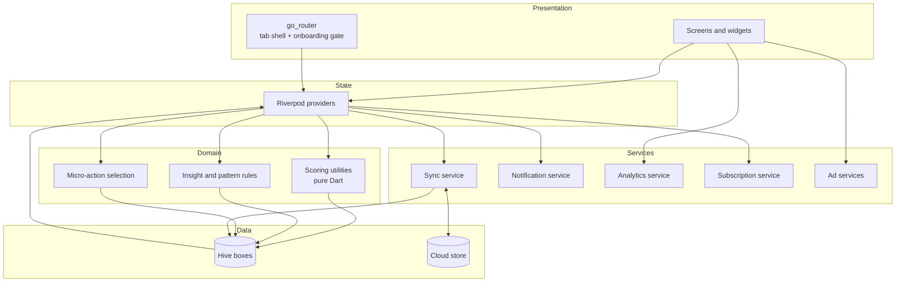
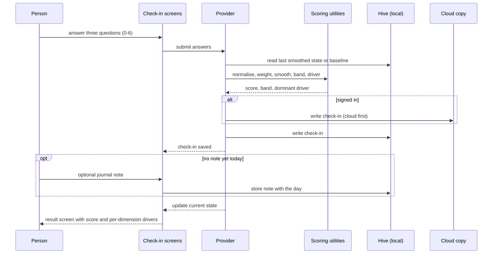
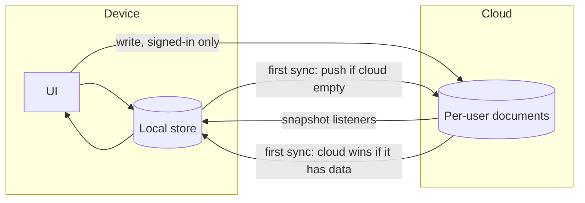
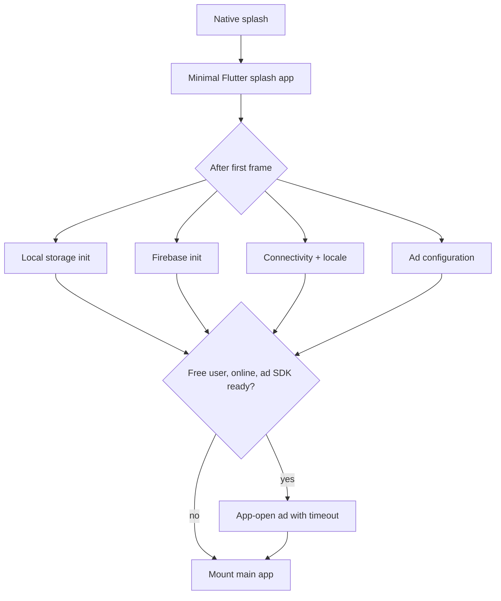
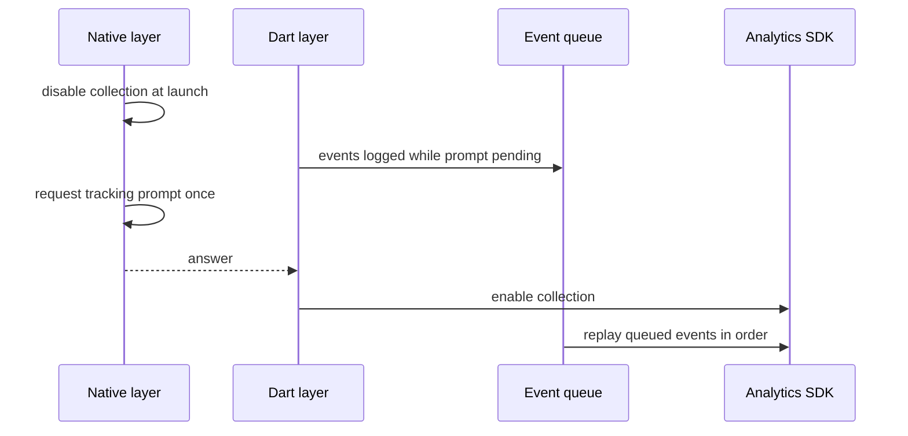

# Architecture

Conceptual diagrams of the Pulse application. Labels describe responsibilities, not production identifiers.

## System overview

  

The app is local-first. Everything on the left, inside the device boundary, works without an account. Firebase services and the ad and billing components are layered on top and can be absent (signed-out user, premium user, offline) without changing how screens read data.

## Layers

| Layer | Responsibility |
|---|---|
| **Presentation** | Four-tab shell (Today, Patterns, Outlook, Settings), onboarding, check-in, result, paywall and settings screens; custom-painted charts |
| **State** | Riverpod providers expose the current score state, recent check-ins, premium status, sync status and onboarding progress |
| **Domain** | Pure scoring utilities, weekly summary and pattern rules, micro-action selection. No framework imports, so they are directly unit-testable |
| **Services** | Cloud sync, local notifications, analytics, subscriptions, ad orchestration, connectivity checks, update prompts |
| **Data** | Hive boxes as the only read path for the UI; a per-user cloud store for signed-in users |

## One check-in, end to end

The cloud write exists only for signed-in users, and a signed-in journal note is also written to the cloud. The UI always renders from local state afterwards.

## Sync model

Key behaviours in words:

- **One read path.** The UI reads local storage only. Listener callbacks update local storage and then nudge dependent providers to re-read.
- **First-sync rule.** An empty cloud receives the local data. A populated cloud is merged into and then becomes the source of truth.
- **Stale-sync guard.** A generation counter invalidates sync work that started before a sign-out.
- **Safety upload.** Before sign-out or reset, a final upload runs so recent entries are not lost.
- **Guests.** Check-in, baseline and journal data stay on the device unless the person signs in. Push-messaging registration and remote ad configuration use cloud services for every install, and analytics and crash reporting run as described in the technical case study.

## Start-up sequence

Each wait has an upper bound. On iOS, analytics collection and ad initialisation additionally follow the tracking-transparency prompt (see below).

## Analytics ordering on iOS

A timeout prevents the queue from waiting forever if the prompt never resolves.

## Component responsibilities

| Component | Notes |
|---|---|
| **Scoring utilities** | Normalisation, weighting, exponential smoothing, band mapping and driver selection. Deterministic and independent of storage |
| **Insight rules** | Weekly summary and pattern detectors. Persist a type and metadata; sentences are built from localized templates at render time |
| **Micro-action selector** | Filters a static library by band, driver and duration, excludes recent actions, falls back progressively |
| **Sync service** | Singleton for signed-in users. Batched writes, listeners, generation counter, safety upload |
| **Notification service** | Daily reminder with a user-selected time; scheduling differs per platform; taps deep-link into the check-in |
| **Subscription service** | Store products, purchase and restore flows, local entitlement with a silent refresh on launch |
| **Ad services** | Mediation SDK, placement switches and a global switch from remote configuration, cooldowns and a watchdog for stuck full-screen ads |
| **Analytics service** | Validation, queueing, session tracking, route and overlay observation, typed crash non-fatals, performance traces |

## Honest limits of the architecture

- Entitlement checks are client-side; server-side receipt verification is the planned next step.
- Journal text is stored on the device; adding encryption at rest is planned.
